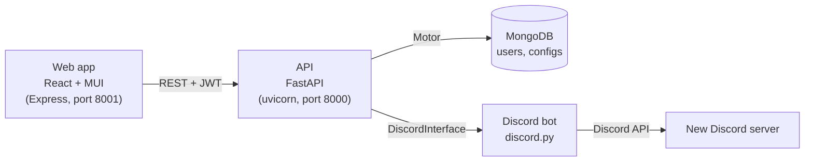

# DiscordRC

DiscordRC is a web app that lets you design a Discord server (roles, categories, channels, and permissions) in a form, save it as a reusable JSON template, and have a bot create the fully configured server for you.

**Tech stack:** Python, FastAPI, Pydantic, MongoDB (Motor async driver), JWT authentication (OAuth2 password flow, bcrypt), discord.py, React 18, React Router, Material UI (MUI), Express, Webpack, Babel, pytest, Docker, GitHub Actions CI

## Features

- **Visual server designer:** a React + Material UI form for defining roles, role permissions, categories, text and voice channels, and per-role channel permission overwrites.
- **Reusable templates:** save server configurations to your account and load them later, stored as JSON documents in MongoDB.
- **One-click server creation:** the bot creates a new Discord server from a template, returns an invite link, transfers ownership to the first user who joins, then leaves.
- **Community server support:** creates the rules and updates channels Discord requires and applies the configuration once the server is switched to a Community server.
- **Account system:** sign up and log in with username and password; the API issues JWT access tokens and hashes passwords with bcrypt.
- **Read and write existing servers:** the `ruco` bot module can export an existing server's structure to JSON and apply a JSON config to a server.

## Architecture



- **Web app (`webapp/`):** React single-page app bundled with Webpack and served by a small Express server. Pages: login/sign-up, server selection (saved templates), configuration form, and a final page to create the server or save the template.
- **API (`api/`):** FastAPI service with four routers: `/auth` (signup, login, JWT), `/users` (current user and saved templates), `/config` (import/export templates to MongoDB), and `/bot` (create a server from a config). Request and response bodies are validated with Pydantic models. Interactive docs are served at `/docs`.
- **Discord bot (`DiscordBot/`):** `DiscordInterface` runs a `GuildCreatorBot` per request in its own thread so the blocking discord.py client does not stall the API. The `ruco` package (read, write, permissions) translates between a JSON config and Discord API calls, including permission overwrites for text, voice, forum, stage, announcement, rules, and updates channels.

## Server config format

A server template is JSON with roles and categories. Channel permissions map a permission name to a role-to-boolean map:

```json
{
  "name": "MyServer",
  "community": false,
  "roles": [
    { "name": "Moderator", "permissions": ["kick_members", "manage_messages"] }
  ],
  "categories": [
    {
      "name": "General",
      "text_based_channels": [
        { "name": "chat", "channel_type": "TEXT", "permissions": { "send_messages": { "Moderator": true } } }
      ],
      "voice_based_channels": []
    }
  ]
}
```

See `api/models.py` for the full schema and `DiscordBot/tests/default.json` and `DiscordBot/tests/community.json` for complete examples. `example_config.json` is a minimal example that validates against `ServerConfig`.

## Getting started

**Prerequisites:** Python 3.11+, Node.js, Docker, and a Discord bot token.

### 1. Environment

Configuration is read from environment variables. Copy the template, fill in values, and load it into your shell:

```bash
cp .env.example .env    # set MONGO_USERNAME, MONGO_PASSWORD, JWT_SECRET_KEY, DISCORD_TOKEN
set -a; . ./.env; set +a
```

`MONGO_USERNAME` and `MONGO_PASSWORD` are required. If `JWT_SECRET_KEY` is unset, the API generates a random key at startup (fine for local development, but tokens stop working after a restart).

### 2. Database

```bash
cd api
./mongo_setup.sh   # starts a local MongoDB container on port 27017 using MONGO_USERNAME / MONGO_PASSWORD
```

### 3. API

```bash
cd api
python3 -m venv venv
. venv/bin/activate
pip3 install -r requirements.txt
sh -c 'cd .. && uvicorn api.main:app --reload'
```

The API must be started from the repository root (the command above does this) so that it can import `DiscordBot/`. API docs are at http://localhost:8000/docs.

### 4. Web app

```bash
cd webapp
npm install
npm run build   # bundles into webapp/public
npm start       # serves on http://localhost:8001
```

### Tests

With the environment variables loaded, the MongoDB container running, and the API stopped:

```bash
api/tests/run_tests.sh
```

The script starts the API against a test database, runs the pytest suite (auth, users, config), and cleans up.

## CI/CD

- **API tests** (`.github/workflows/api_tests.yml`): on every pull request to `main`, starts a MongoDB service container with throwaway CI credentials, installs dependencies, and runs the pytest suite.
- **Webapp build** (`.github/workflows/webpack.yml`): on every push, runs the Webpack build and commits the updated bundle in `webapp/public` so the build output stays in sync with the source.
- **Epics** (`.github/workflows/epics.yml`): keeps epic issue checklists in sync as story issues are closed or reopened.

## Repository layout

```
DiscordBot/          Discord bot: guild creation, ruco read/write/permissions engine
api/                 FastAPI backend, MongoDB access, routes, pytest suite
webapp/              React + MUI front end, Express server, Webpack config
documentation/       Generated HTML reference docs for the API and bot modules
example_config.json  Minimal example server config
.github/             CI workflows, issue and pull request templates
```

## Project context and team

Built by a team of five as a course project for UCLA CS 130 (Software Engineering), January to March 2024, using a Scrum process with GitHub issues, epics, and sprint milestones.

- **Seth Carlson ([@sdcarlson](https://github.com/sdcarlson)):** set up the repository and Scrum workflow (issue and PR templates, epics automation), wrote the initial FastAPI entry point and MongoDB Docker setup, and built the web app's authentication and navigation: login and sign-up pages, React Router routing, JWT storage in the browser, the server selection page backed by the `/users/me` endpoint, log out, and styling.
- **Quan Do ([@biquando](https://github.com/biquando)):** FastAPI backend (auth, users, config, and bot routes), MongoDB integration, API test suite, CI, and generated documentation.
- **Kevin Jin ([@kevwjin](https://github.com/kevwjin)):** `ruco` bot module for reading and writing server configs and Discord permissions.
- **[@mynusplus](https://github.com/mynusplus):** `GuildCreatorBot` and `DiscordInterface` for threaded server creation and ownership handoff.
- **Garrick Su:** web app configuration form and permission editor components, webapp build workflow.

## License

Apache License 2.0. See [LICENSE](LICENSE).
